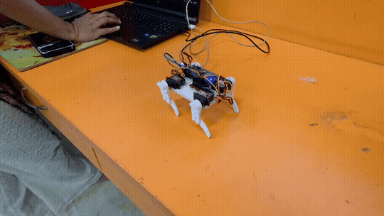
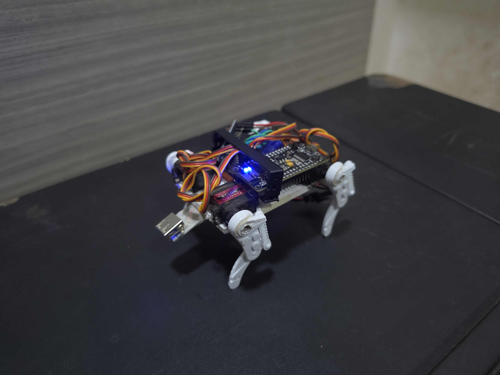
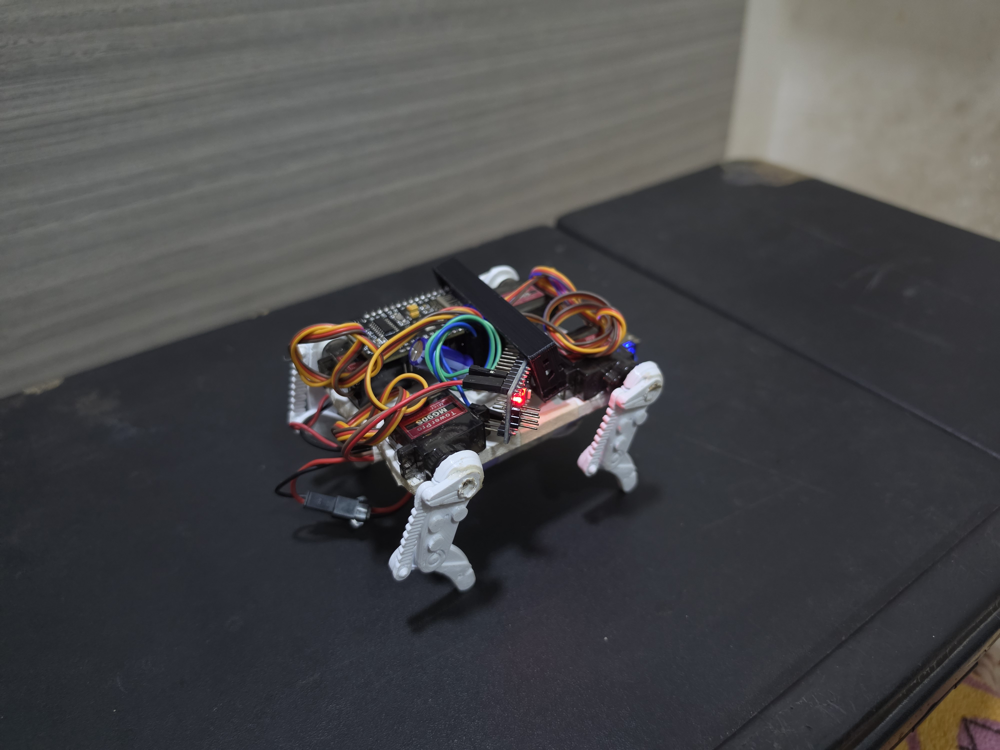
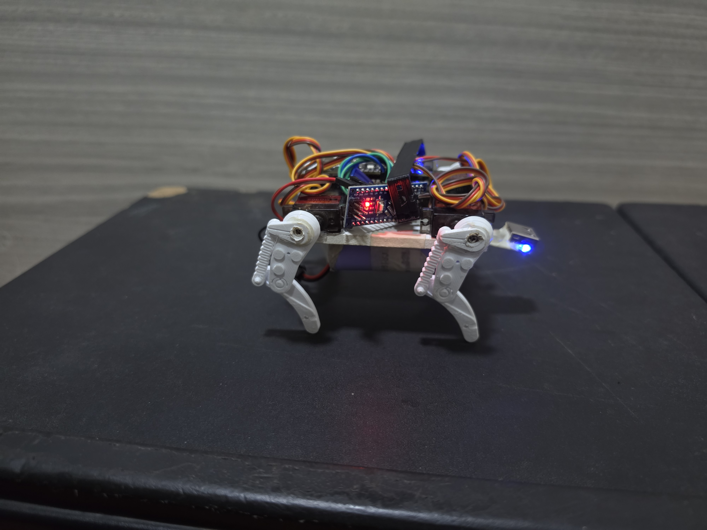
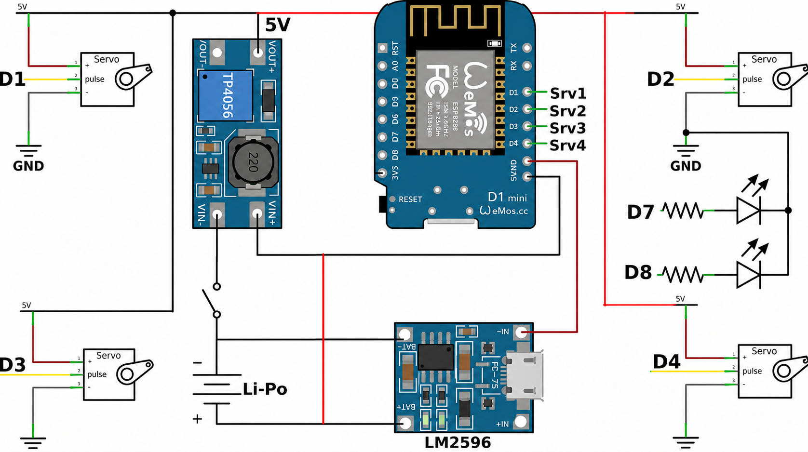
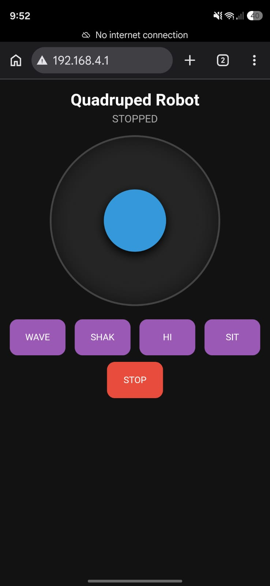
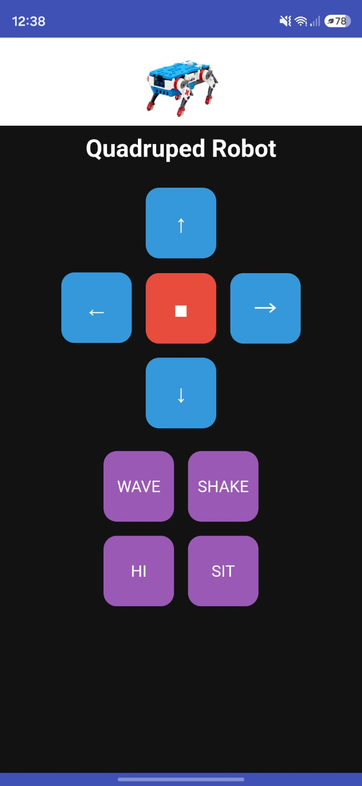

<div align="center">
  <h1>🤖 Quaddle</h1>
  <p><strong>The World’s Simplest Quadruped Robot</strong></p>
  
  <p>
    
    
    
    
  </p>

  
  <p><em>Quaddle physical prototype walking during testing</em></p>
</div>

<br />

> **Quaddle** is a beginner-friendly, Wi-Fi-controlled quadruped robot powered by an ESP8266 or ESP32 microcontroller. Designed to be the "world's simplest" robot dog, it utilizes a 1-DOF (Degree of Freedom) design per leg, eliminating the need for complex inverse kinematics or heavy mathematics. Quaddle hosts its own built-in web interface and also includes an optional Android app, allowing you to control it seamlessly from any device.

---

## 📑 Table of Contents
- [Features](#-features)
- [Working Prototype & Video Demo](#-working-prototype--video-demo)
- [Repository Structure](#-repository-structure)
- [Bill of Materials (BOM)](#-bill-of-materials-bom)
- [Circuit & Wiring](#-circuit--wiring)
- [3D Printing & Assembly](#️-3d-printing--assembly)
- [Software Installation](#-software-installation)
- [Usage & Control](#-usage--control)
- [Interfaces](#-interfaces)

---

## 🌟 Features

- **Simple Hardware:** Uses only 4 micro servos (SG90) and common, affordable components.
- **Wi-Fi Control:** Fully controlled via a lightweight, mobile-friendly web interface hosted directly on the ESP.
- **Dedicated Android App:** Includes a pre-built Android APK (`Quaddle.apk`) for dedicated smartphone control.
- **No App Required:** Works on any device with a modern web browser via its IP address.
- **Easy Assembly:** Fully 3D printable chassis with snap-in designs for the servos and components.
- **Pre-programmed Animations:** Includes actions like moving, turning, waving, sitting, and tail shaking!

---

## 🤖 Working Prototype 

Here is the physical assembled prototype of Quaddle in action:

### 📸 Prototype Photos

<div align="center">
  <table>
    <tr>
      <td align="center" width="33%">
        
        <br/>
        <b>Isometric Angle View</b>
        <br/>
        <sub>3D printed legs, micro servos & NodeMCU controller</sub>
      </td>
      <td align="center" width="33%">
        
        <br/>
        <b>Side & Wiring View</b>
        <br/>
        <sub>Power harness, status LEDs & chassis mounting</sub>
      </td>
      <td align="center" width="33%">
        
        <br/>
        <b>Front Stance View</b>
        <br/>
        <sub>1-DOF leg design with mechanical linkages</sub>
      </td>
    </tr>
  </table>
</div>

<!-- ### 🎥 Walking Demonstration Video

Watch Quaddle walking on a flat surface while receiving motion commands over Wi-Fi:

<div align="center">
  <video src="Quaddle_Prototype/prototype-demo.mp4" controls="controls" width="600" style="max-width: 100%; border-radius: 10px; box-shadow: 0 4px 12px rgba(0,0,0,0.15);">
    <a href="Quaddle_Prototype/prototype-demo.mp4">▶️ Watch / Download Demo Video (MP4)</a>
  </video>
  <p>
    🔗 <em>Direct links:</em> 
    <a href="Quaddle_Prototype/prototype-demo.mp4"><strong>Watch / Download MP4</strong></a> | 
    <a href="Quaddle_Prototype/WhatsApp%20Video%202026-10-23%20at%209.44.37%20PM.mp4">Original Recording</a>
  </p>
</div>

--- -->

## 📂 Repository Structure

```text
Quaddle/
├── QuaddleCode/           # Arduino source code (C++) for the ESP8266/ESP32.
├── Quaddle_STL/           # 3D models (STL files) and Blender source files for printing the robot.
├── Quaddle_Prototype/     # Photos and video demonstration of the physical robot prototype.
├── QuaddleApp/            # Android application APK for controlling the robot.
├── codeDirectWifi_v1.ino/ # Alternative Wi-Fi code (Direct AP mode).
├── SchematicPro.png       # Circuit diagram for wiring components.
└── README.md              # Project documentation.
```

---

## 📦 Bill of Materials (BOM)

| Component | Description / Specification |
| :--- | :--- |
| **Microcontroller** | NodeMCU (ESP8266) or ESP32 Development Board |
| **Actuators** | 4x SG90 Micro Servos |
| **Power** | 3.7V LiPo Battery (18650 or similar) |
| **Charging Module** | TP4056 Module with Battery Protection |
| **Voltage Regulation**| 5V Step-Up (Boost) Converter (for servos & ESP) |
| **LEDs** | 2x LEDs (for Quaddle's "eyes") |
| **Capacitor** | 1500µF or similar (placed on servo power line to smooth startup current spikes) |
| **Switch** | SPDT Slide Switch |
| **Hardware** | Jumper wires, small screws for servos |

---

## 🔌 Circuit & Wiring

Here is the general schematic representation to help you connect all the components correctly:

<div align="center">
  
</div>

### Pin Connections (Based on NodeMCU / ESP8266)

| Component | ESP Pin | Notes |
| :--- | :--- | :--- |
| **Front Left Servo** | `D1` | |
| **Front Right Servo** | `D2` | |
| **Back Left Servo** | `D3` | |
| **Back Right Servo** | `D4` | |
| **Left Eye LED** | `D7` | Connect with appropriate current-limiting resistor. |
| **Right Eye LED** | `D8` | Connect with appropriate current-limiting resistor. |

*Note: Ensure the servos are powered directly from the 5V boost converter output, NOT from the ESP's 3.3V logic pins. Connect the common ground!*

---

## 🖨️ 3D Printing & Assembly

All necessary 3D models are located in the `Quaddle_STL` folder.
- You can print individual parts or use the provided `all_in_one_quaddle` STL files.
- **Recommended Settings:** 0.2mm layer height, 15-20% infill, PLA or PETG. No supports required for most parts.
- Check the original Blender (`.blend`) files included if you wish to modify the design.

---

## 💻 Software Installation

1. Install the [Arduino IDE](https://www.arduino.cc/en/software).
2. Install the ESP8266 or ESP32 board manager in the Arduino IDE.
3. Open `QuaddleCode/QuaddleCode.ino` in the Arduino IDE.
4. Locate the Wi-Fi configuration section at the top of the code and update it with your network credentials:

   ```cpp
   const char* ssid = "YOUR_WIFI_SSID";
   const char* password = "YOUR_WIFI_PASSWORD";
   ```

5. Connect your ESP board via USB.
6. Select the correct board (e.g., **NodeMCU 1.0 (ESP-12E Module)**) and COM port from the Tools menu.
7. Click **Upload** to compile and flash the firmware.

---

## 🚀 Usage & Control

1. After a successful upload, open the **Serial Monitor** in the Arduino IDE.
2. Set the baud rate to `115200`.
3. Press the **RST (Reset)** button on the ESP board.
4. Wait for it to connect to your Wi-Fi network. Once connected, it will display an **IP Address** (e.g., `192.168.4.1`).
5. Ensure your phone or PC is connected to the *same Wi-Fi network*.
6. Open a web browser and navigate to the displayed IP address.
7. You will see the Quaddle control interface. Enjoy driving your robot!

*(If the robot remains idle for 3 minutes, it will automatically play a "shake tail" animation!)*

---

## 📱 Interfaces

### Web Dashboard
Control Quaddle directly from any browser! The web interface is lightweight and mobile-friendly:

<div align="center">
  
</div>

### Android App
If you prefer a native application, a pre-compiled Android App is provided.

<div align="center">
  
</div>

- Navigate to the `QuaddleApp` directory.
- Download and install `Quaddle.apk` on your Android device.
- Open the app, configure it with your ESP's IP Address, and start controlling Quaddle!

---

